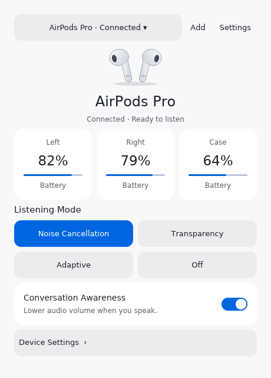
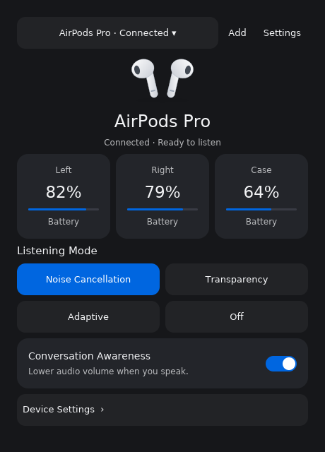

# Airpods Driver for Linux

Check your AirPods battery, switch listening modes, and control your headphones from your Linux desktop.

## Features

- Check the charge of your earbuds and case, and get notified at 20% or below.
- Reduce background noise or let your surroundings in by switching listening modes.
- Lower playback volume while you speak with Conversation Awareness, and adjust it to your surroundings with Personalized Volume.
- Pause and resume playback automatically when you take your AirPods out or put them back in.
- Pair your AirPods and switch between saved headphones.
- Check battery levels and change listening modes from the system tray.
- Choose a light or dark theme, skip tracks with stem presses, and start the app at login.

Available features depend on your AirPods model and firmware. Hearing aid controls are not available.

## Install

Download a package from [Releases](https://github.com/VitalyArt/AirPods-Linux-Driver/releases/latest). Choose **amd64 / x86_64** for Intel or AMD computers, or **arm64 / aarch64** for ARM computers.

Choose a format below. For Ubuntu or Fedora, start with the package for your distribution. Run the installation command from the folder containing your download:

| Choose this if… | Package | Install |
| --- | --- | --- |
| Ubuntu 24.04 and compatible distributions | DEB | `sudo apt install ./airpods-driver_*.deb` |
| Fedora 43 and compatible distributions | RPM | `sudo dnf install ./airpods-driver-*.rpm` |
| You want to run the app without installing it | AppImage | `chmod +x airpods-driver-*.AppImage`, then open the file |
| You prefer Flatpak and already have it installed | Flatpak bundle | `flatpak install --user ./airpods-driver-*.flatpak` |

AppImage requires glibc 2.39 or newer, a system library provided by your Linux distribution.

Open **Airpods Driver** from your applications menu, or run the AppImage directly. Run the app as your normal user.

Flatpak may download its runtime from Flathub. You can also launch it with `flatpak run com.vitalyart.airpods-driver`.

## Connect your AirPods

Turn on Bluetooth and open Airpods Driver. AirPods already paired with your computer appear under **Saved headphones**.

To pair for the first time:

1. Select **Change headphones → Add headphones**.
2. Open the case near your computer and put your AirPods into pairing mode until the indicator flashes white. The pairing method depends on your model.
3. Select **Pair** next to your AirPods, or **Connect** if they are already paired.
4. Select them under **Saved headphones** to open their controls.

You can also pair and connect through your computer's Bluetooth settings. Select your AirPods as the sound output in your computer's sound settings.

## Use your AirPods

**Battery.** The main screen shows battery levels and charging indicators. A dash (**—**) means a reading is unavailable. The case may not always report its charge, and nearby readings can be approximate. Low-battery notifications follow your desktop's notification settings.

**Listening modes.** Choose **Noise Cancellation** to reduce surrounding noise, **Transparency** to hear your surroundings, **Adaptive** to adjust noise control automatically, or **Off** to turn noise control off.

**Volume.** Enable **Conversation Awareness** on the main screen to lower playback volume while you speak. To adjust volume to your surroundings, enable **Personalized Volume** in **Device Settings**.

**Device settings.** Open **Device Settings** to allow the **Off** listening mode, rename supported headphones, or view device information.

**System tray.** Use the tray menu to check battery levels, change listening modes, open the window, or quit the app. Tray availability depends on your desktop.

**Switch or forget headphones.** Choose another device through **Change headphones**. To remove one, select **Device Settings → Forget device…** and confirm. This also removes its Bluetooth pairing; you will need to pair it again to use it.

**Keyboard navigation.** Use **Tab / Shift+Tab** to move between controls, **Enter / Space** to activate one, and **Escape** to return to the main screen.

## Preferences

Open **Settings** to adjust:

- **Appearance:** choose a light or dark theme.
- **Start at login:** launch minimized to the system tray. This is enabled on first launch; you can turn it off here.
- **Battery text in tray:** show a percentage instead of the AirPods icon.
- **Stem track controls:** double press to skip a track and triple press to go back. Turn this off if your desktop already handles these gestures.

For AppImage, keep the file in a permanent location. If you move it, turn **Start at login** off and on again.

## Updates

Official packages check for updates automatically once a day. To check manually, open **Settings → Updates → Check for updates**.

Select **Update** to download a new version, then **Install** when you are ready. Your system may ask for your password. The app restarts after installation.

You can turn automatic checks off in the same section. Leave **Preview releases** off for stable updates. Enable it to try early versions, which may contain bugs.

You can also download and install a newer package from [Releases](https://github.com/VitalyArt/AirPods-Linux-Driver/releases/latest).

## Troubleshooting

| Problem | What to try |
| --- | --- |
| AirPods do not appear or will not connect | Check that Bluetooth is on and your AirPods are nearby. Pair or reconnect them through your computer's Bluetooth settings. |
| Connected, but no sound | Select your AirPods as the sound output in your computer's sound settings and check the volume. |
| Battery readings stop updating | Reconnect your AirPods. A missing case reading can be normal. |
| A control is missing or unavailable | Check the connection. Features depend on your model and firmware. |
| No system tray icon | Enable tray support in your desktop. You can still use the main window. |
| AppImage will not start because FUSE is unavailable | Run `./airpods-driver-<version>-<arch>.AppImage --appimage-extract-and-run`, replacing the filename with your download. |
| The app says it is already running after logging in again | Run `pkill -TERM -x airpods-driver`, then reopen the app. |

If the problem continues, [open an issue](https://github.com/VitalyArt/AirPods-Linux-Driver/issues) with your Linux distribution, AirPods model, app version, and what happened.

## About

Based on [LibrePods](https://github.com/kavishdevar/librepods), with thanks to its contributors. See [LICENSE](LICENSE) for license information.
