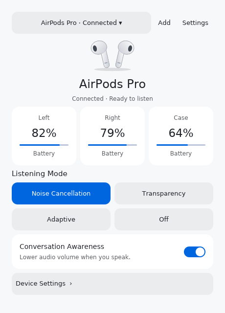
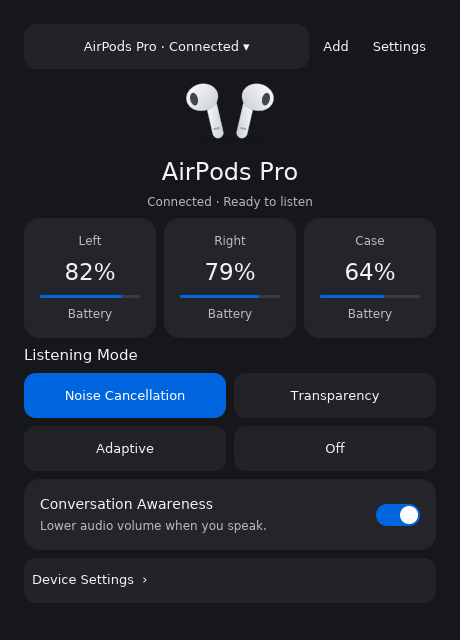

# Airpods Driver for Linux

Your AirPods controls, right on your Linux desktop. Check battery levels, switch listening modes, and adjust your headphones without reaching for your phone.

## What you can do

- Check the battery levels of your earbuds and charging case.
- Receive desktop notifications when a non-charging earbud or case reaches 20% or below.
- Switch between Noise Cancellation, Transparency, Adaptive, and Off modes.
- Enable Conversation Awareness and Personalized Volume.
- Automatically pause and resume playback when you take your AirPods out or put them back in.
- Pair nearby AirPods and switch between saved headphones.
- Access battery readings and listening controls from the system tray.
- Choose a light or dark appearance.
- Start automatically at login, minimized to the system tray.

Available features depend on your headphone model and firmware. Hearing aid controls are not available.

## Install

Download a file for your computer from this repository's **Releases** page.
Choose **amd64 / x86_64** for Intel or AMD computers, or **arm64 / aarch64** for ARM computers.
No application store account or publication is required.

| Format | Installation |
| --- | --- |
| DEB (Ubuntu 24.04 and compatible distributions) | `sudo apt install ./airpods-driver_*.deb` |
| RPM (Fedora 43 and compatible distributions) | `sudo dnf install ./airpods-driver-*.rpm` |
| AppImage (portable application) | `chmod +x airpods-driver-*.AppImage`, then open the file |
| Flatpak bundle | `flatpak install --user ./airpods-driver-*.flatpak` |

Native packages require compatible system libraries. AppImages built on Ubuntu 24.04
require glibc 2.39 or newer and a working desktop graphics stack.
Flatpak requires Flatpak installed
and may download its Freedesktop runtime from Flathub; the application itself is installed
from the downloaded file. Start it with `flatpak run com.vitalyart.airpods-driver`.
AppImage can also run without FUSE using `./airpods-driver-<version>-<arch>.AppImage --appimage-extract-and-run`.

Installed packages include the application launcher and icon. Open **Airpods Driver** from your
applications menu, or run the AppImage directly. Run the application as your normal user.

See [packaging instructions](docs/packaging.md) for building and checking the packages.
With Docker running, `make build-packages` builds all four formats into `dist/`.
The compiler, libraries and packaging tools are installed inside the container.

## Get started

Turn on Bluetooth on your computer and open Airpods Driver. If your AirPods are already paired in your computer's Bluetooth settings, they will appear in the saved headphones list automatically.

To pair AirPods for the first time:

1. Select **Change headphones** and look for **Add headphones**.
2. Open the case near your computer.
3. Put your AirPods into pairing mode using the method for your model, until the indicator flashes white.
4. Select **Pair** next to your AirPods. If they are already paired, select **Connect**.
5. Select them under **Saved headphones** to open their controls.

You can also pair AirPods through your computer's Bluetooth settings, then return to Airpods Driver.

## Check your battery

The main screen shows the available battery readings for your headphones and case. Charging indicators help you see which parts are charging.

A dash (**—**) means a reading is currently unavailable. The case may not always report its battery level, and nearby readings can be approximate. Reconnect your headphones if readings stop updating.

Low-battery notifications are automatic and need no configuration. Each component alerts once at 20% or below, and can alert again after its charge reaches 30%. Reconnecting does not repeat an alert during the same application session. Notifications require a desktop notification service and follow your desktop’s notification settings.

## Choose how you listen

Select a listening mode on the main screen:

| Mode | What it does |
| --- | --- |
| Noise Cancellation | Reduces surrounding noise. |
| Transparency | Lets you hear your surroundings. |
| Adaptive | Adjusts noise control to your surroundings. |
| Off | Turns noise control off. |

Use **Conversation Awareness** to lower playback volume while you speak. In **Device Settings**, you can enable **Personalized Volume** to adjust volume to your surroundings, or allow the **Off** listening mode.

These controls require connected headphones that support the feature. A control may be temporarily unavailable while a change is being applied.

## Use the system tray

The Airpods Driver icon in your desktop's system tray gives you quick access to battery readings, listening modes, and Conversation Awareness. You can also open or quit Airpods Driver from its menu.

Enable **Battery text in tray** in **Settings** if you prefer a percentage instead of the headphone icon. Tray availability and appearance depend on your desktop.

## Make it yours

Open **Settings** to choose a light or dark theme and adjust **Stem track controls**. With these controls enabled, double press to skip a track and triple press to go back. Turn them off if your desktop already handles these gestures.

To rename supported headphones, open **Device Settings**, enter a name, and save the change. You can also view information about your headphones there.

## Switch or forget headphones

Select **Change headphones** to choose another device from **Saved headphones**. Saved AirPods remain listed when disconnected.

To remove headphones, open **Device Settings → Forget device…** and confirm. This also removes their pairing from your computer's Bluetooth settings. To use them again, pair them again.

If you forget AirPods through your computer's Bluetooth settings, they are also removed from Airpods Driver. They may still appear as nearby headphones, ready to be paired again.

## Keyboard navigation

- **Tab** and **Shift+Tab** move between controls.
- **Enter** or **Space** activates a control.
- **Escape** returns to the main screen.

## Need help?

**My headphones do not appear.** Make sure Bluetooth is on and your headphones are nearby. Put them into pairing mode, or pair them in your computer's Bluetooth settings and return to Airpods Driver.

**My headphones are listed but disconnected.** Look for **Connect** under **Add headphones**, or reconnect them through your computer's Bluetooth settings.

**My headphones are connected, but I cannot hear anything.** Select them as the sound output in your computer's sound settings and check the volume.

**A feature is missing or unavailable.** Check that your headphones are connected. Features vary by model and firmware, so not every device offers every control.

**I cannot see the system tray icon.** Your desktop may need tray support enabled. You can still use the main Airpods Driver window.

**After logging out and back in, the app says it is already running but has no tray icon.** An older process may still belong to the previous desktop session. Run `pkill -TERM -x airpods-driver`, then start `airpods-driver` again. Do not delete the lock file: it protects against running two instances. Updated builds monitor the graphical login session through systemd-logind and exit when that session closes.

**The dock shows an old or generic icon.** Restart Airpods Driver. If it is pinned to your dock, try unpinning it and pinning the running application again.

## About Airpods Driver

Based on [LibrePods](https://github.com/kavishdevar/librepods), with thanks to the project and its contributors. See [LICENSE](LICENSE) for license information.

Autostart is enabled on first launch, including after upgrading from a version without this feature.
Use **Settings → Start at login** to disable it. Later updates preserve your choice.
For AppImage, keep the file in a permanent location; if you move it, toggle this setting off and on again.

## Desktop integration API

The application provides a session D-Bus API for device state and listening modes,
and publishes connected headphone charge through BlueZ where BatteryProvider is
available. See [desktop integration](docs/desktop-integration.md) for commands,
requirements, and verification.
